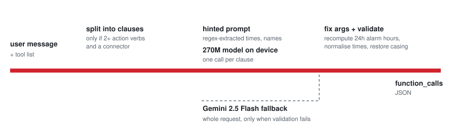

<h1 align="center">FunctionGemma Hackathon</h1>

<p align="center">Function calling with a 270M-parameter model that runs on the device, built for the Cactus Evals hackathon.</p>

<p align="center">
<picture>
<source media="(prefers-color-scheme: dark)" srcset="docs/how-it-works-dark.svg">

</picture>
</p>

<p align="center">The request path in <code>generate_hybrid()</code> (<code>main.py</code>), drawn from the code.</p>

## Why

A 270M model is fast and runs locally, but it often gets arguments wrong and struggles with several tool calls in one message. This entry compensates with rule-based hints before the model call, one model call per clause, and argument repair afterwards. A cloud model is called only when on-device output fails validation.

## What it does

Given a user's natural language message and a set of available tools (functions), the system must:

1. Identify which tool(s) to call
2. Extract the correct arguments from the message
3. Return structured JSON with the function call(s)

For example:

> **User:** "Set an alarm for 7:30 AM and check the weather in New York."
>
> **Output:**
> ```json
> {
>   "function_calls": [
>     {"name": "set_alarm", "arguments": {"hour": 7, "minute": 30}},
>     {"name": "get_weather", "arguments": {"location": "New York"}}
>   ]
> }
> ```

The system runs on-device using `functiongemma-270m-it` via the Cactus runtime, with `gemini-2.5-flash` as a cloud fallback.

The entry was ranked top 5 on the Singapore evaluation leaderboard (reported by the author; no results are committed in this repo).

## Supported Tools

| Tool | Description |
|---|---|
| `get_weather` | Get current weather for a city |
| `set_alarm` | Set an alarm (hour + minute in 24h format) |
| `send_message` | Send a message to a named contact |
| `create_reminder` | Create a reminder with a title and time |
| `search_contacts` | Search for a contact by name |
| `play_music` | Play a song or playlist |
| `set_timer` | Set a countdown timer in minutes |

## How It Works

### On-Device Inference (`main.py`)

The core logic lives in `generate_hybrid()` and uses several layers of optimisation to squeeze accuracy out of a 270M model:

**1. Hinted prompts**
Before calling the model, the prompt is pre-populated with hints extracted by rule-based parsing (regex). This includes:
- Time values converted to the correct format (`3:00 PM`, `7:30 AM`)
- Alarm hours converted to 24-hour integers
- Recipient/location/query names copied verbatim from the message

This reduces ambiguity and gives the model maximum context in minimal tokens.

**2. Multi-tool clause splitting**
Requests containing multiple actions (e.g., "set an alarm *and* check the weather") are split into individual clauses. The model is called once per clause — small models handle one tool at a time far more reliably than generating multiple tool calls in one shot.

**3. Argument post-processing**
After inference, arguments are normalised and validated:
- Time strings are normalised to `HH:MM AM/PM`
- Alarm hours are recomputed from the original message (the model often gets 24h conversion wrong)
- Reminder titles have time expressions stripped out
- Proper-noun casing is restored for names and locations

**4. Cloud fallback**
If on-device inference fails validation, the system tries `gemini-2.5-flash` as a best-effort fallback. If that call raises (for example no API key), the on-device result is returned as is. The author reports the cloud is unavailable in the eval environment (not verifiable from this repo).

## Scoring

Submissions are evaluated on three metrics, weighted by difficulty:

| Metric | Weight |
|---|---|
| F1 score (accuracy of tool calls) | 60% |
| Time score (faster → higher, capped at 500ms baseline) | 15% |
| On-device ratio (higher local usage → higher score) | 25% |

**Difficulty weights:**
- Easy (single tool, direct request): 20%
- Medium (2–4 tools presented, must pick the right one): 30%
- Hard (multiple tools required, compound requests): 50%

## Project Structure

```
.
├── main.py          # Core function-calling logic (submit this)
├── benchmark.py     # Local benchmark runner with 30 test cases
└── submit.py        # Submission script for the Cactus Evals leaderboard
```

## Setup

This project requires the [Cactus](https://github.com/cactus-compute/cactus) runtime and the `functiongemma-270m-it` model weights:

```
cactus/
├── python/src/      # Cactus Python bindings
└── weights/
    └── functiongemma-270m-it/
```

For the cloud fallback, set your Gemini API key:

```bash
export GEMINI_API_KEY=your_key_here
```

## Running Locally

**Run the benchmark** (30 test cases across easy / medium / hard):

```bash
python benchmark.py
```

**Submit to the leaderboard:**

```bash
python submit.py --team "YourTeamName" --location "SF"
```

The submit script uploads `main.py`, queues it for evaluation on the server, and polls for results, printing your final score, F1, average latency, and on-device percentage.
